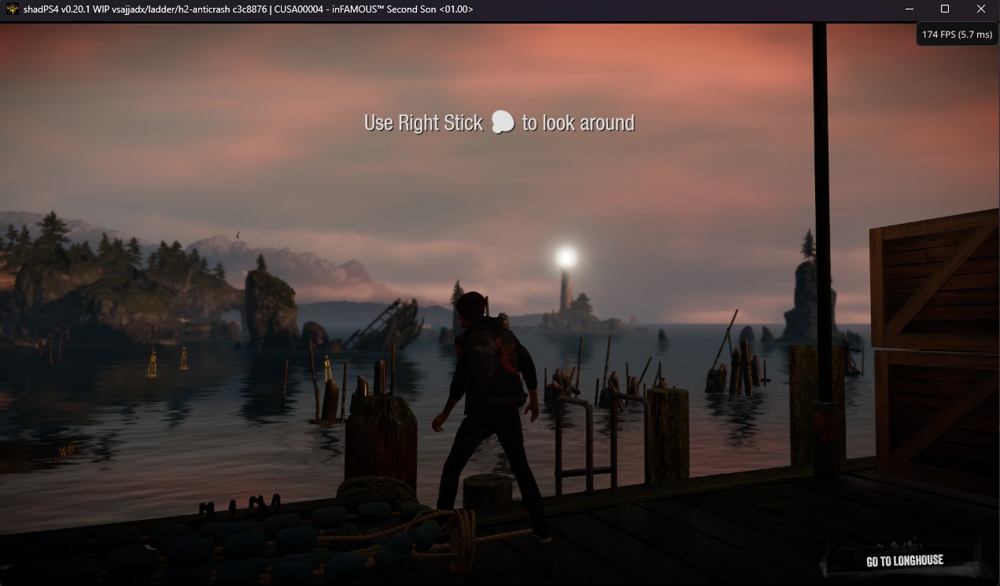
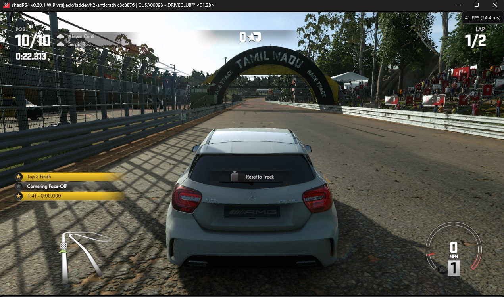
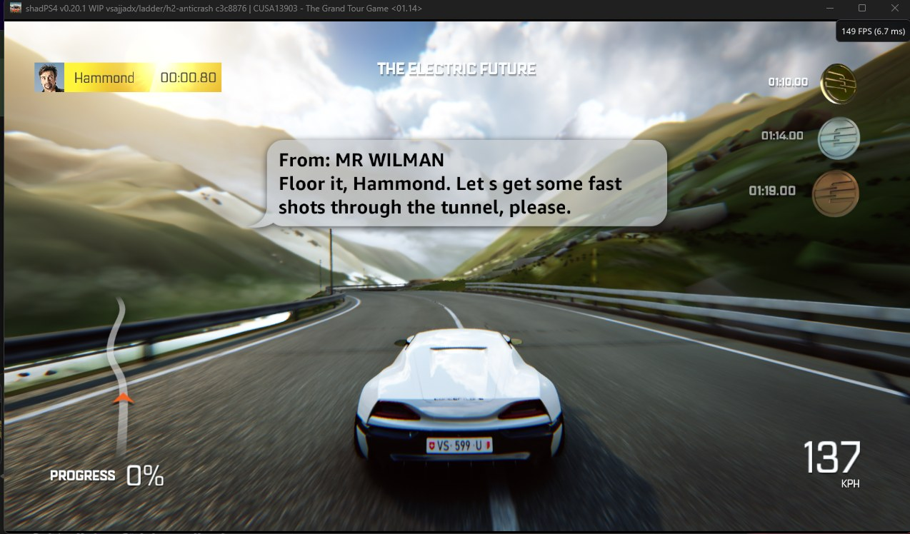
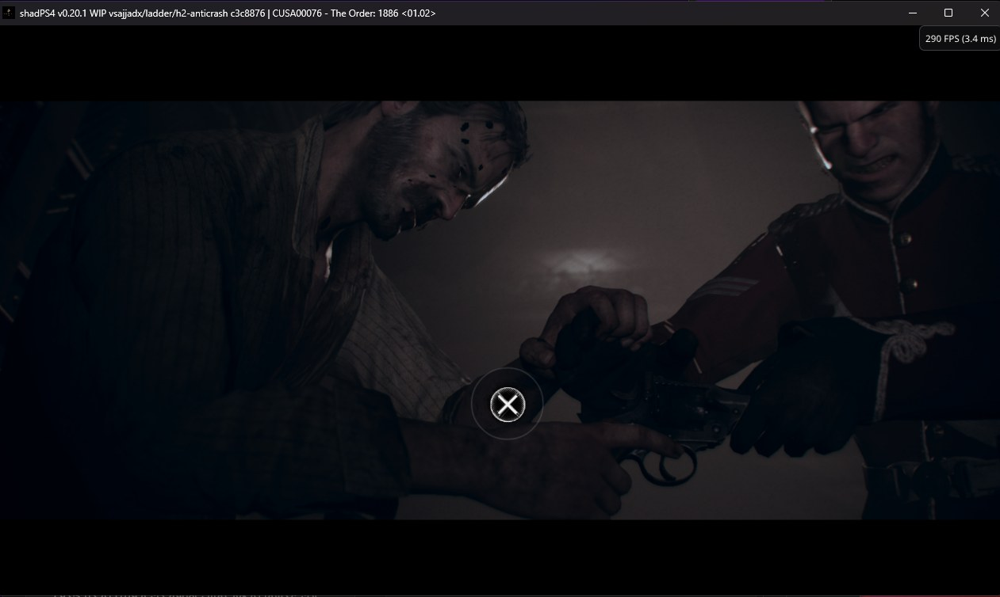
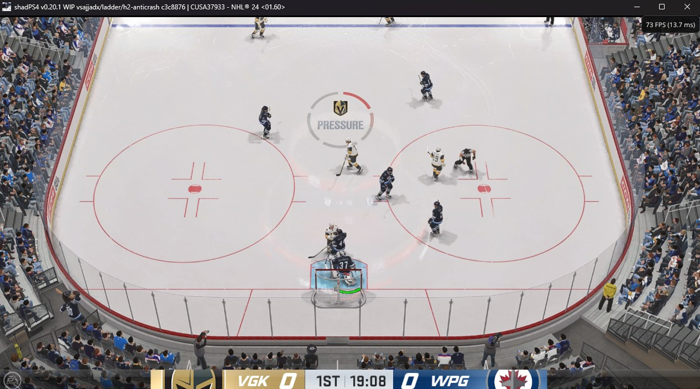
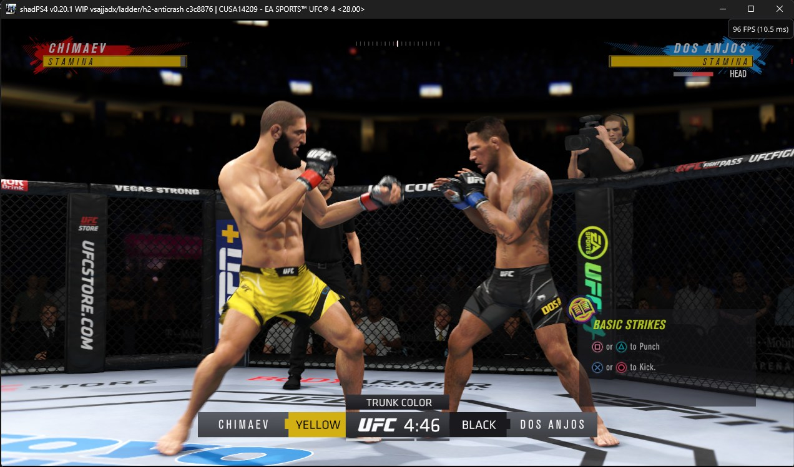
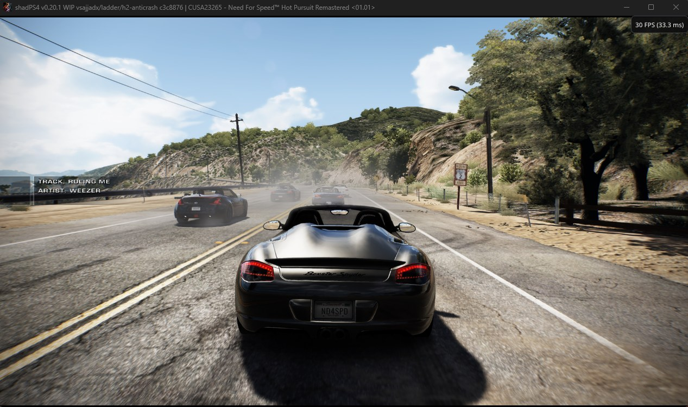
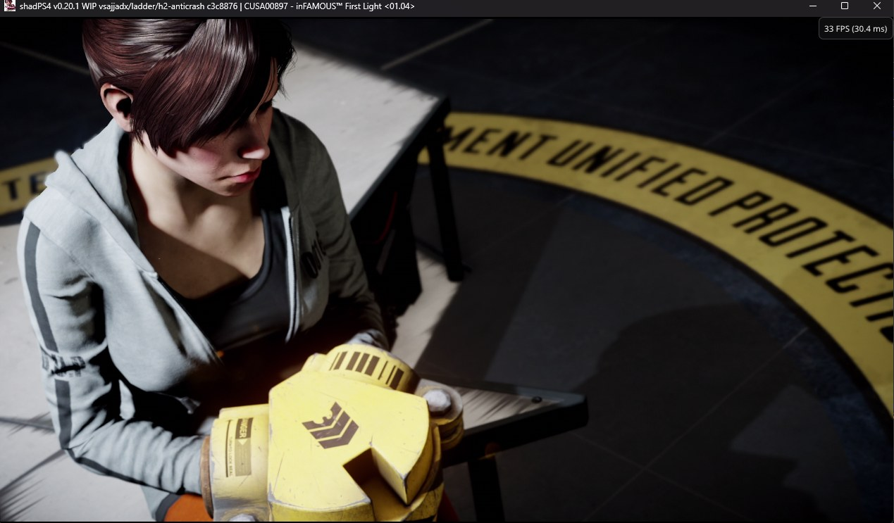
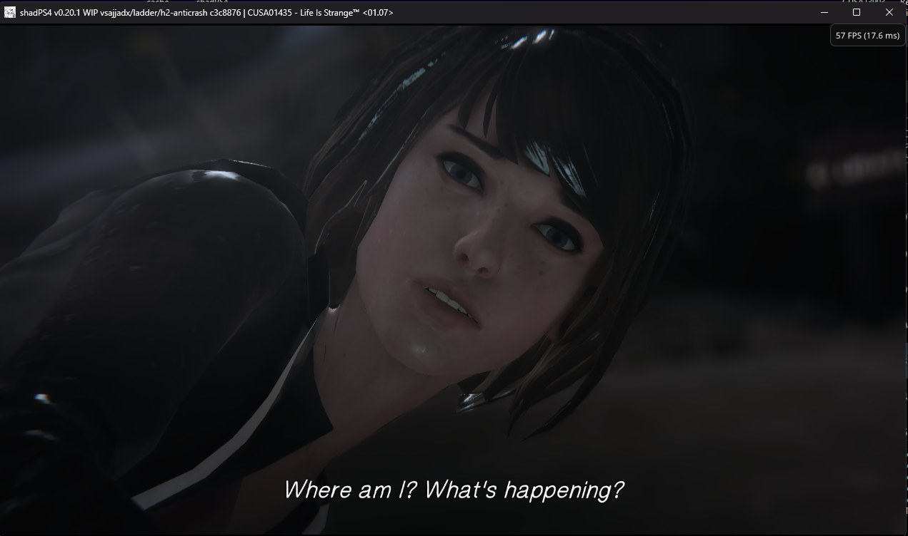
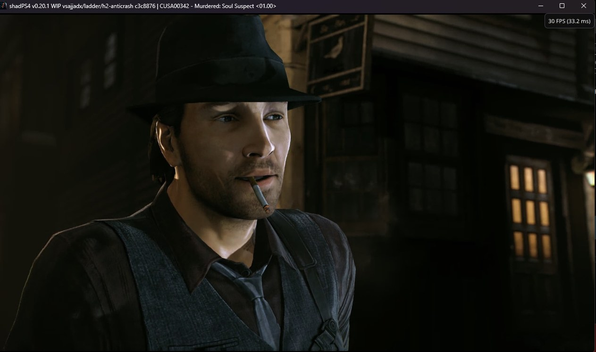

<!--
SPDX-FileCopyrightText: 2026 shadPS4 Emulator Project
SPDX-License-Identifier: GPL-2.0-or-later
-->

<h1 align="center">
   
  
   
  <b>shadPS4 Anti-Crash</b>
   
</h1>

A PlayStation 4 emulator for Windows, built to crash less and run more games.

## Download and play

1. Download the latest zip from [**Releases**](https://github.com/vsajjadx/shadPS4/releases).
2. Unzip it and run `shadPS4QtLauncher.exe`.
3. Add your games folder and play.

**No separate launcher is needed.** The launcher and the emulator come together in one zip.

**No extra settings are needed.** You don't have to change anything in the config or make
per-game settings. The default settings work.

> The first time you start a game it can be a little slower while shaders are built. After
> that it runs normally.

## The launcher

The zip includes the latest official shadPS4 Qt launcher, with a few additions:

- **Automatic updates.** When a new version is released here, the launcher tells you when it
  starts. Press **Update** and it downloads the new version, replaces itself and the emulator,
  and opens again.
- **Your saves are safe.** The launcher uses the save and settings folders you already have.
  It only makes new ones if none exist, and updates never touch them.
- **Easy window size.** Pick the size from a list (720p, 1080p, 1440p, 4K and more) instead of
  typing numbers.
- **Frame generation switch.** Turn on FSR 3.1 frame generation in **Settings → Graphics**.
- **Compatibility list.** Shows the official list, plus the games this build runs that the
  official one doesn't.
- **Install PKG files.** **File → Install Packages (PKG)** installs games, updates and DLC,
  like shadPS4 v0.7.

> Already using the official launcher with a `user` folder next to it? Unzip into that same
> folder and replace the files. Your games, saves and settings stay as they are.

## Screenshots

| inFAMOUS Second Son | DRIVECLUB |
| :---: | :---: |
|  |  |

| The Grand Tour Game | The Order: 1886 |
| :---: | :---: |
|  |  |

| NHL 24 | EA SPORTS UFC 4 |
| :---: | :---: |
|  |  |

| Need for Speed Hot Pursuit Remastered | inFAMOUS First Light |
| :---: | :---: |
|  |  |

| Life Is Strange | Murdered: Soul Suspect |
| :---: | :---: |
|  |  |

## What is different from the official shadPS4

- **Fewer crashes.** Many errors that used to close the emulator are now caught, and the game
  keeps running.
- **Fewer freezes.** Fixes for games that got stuck on loading screens.
- **Better graphics.** Fixes for dark scenes, lighting and shadows, especially on NVIDIA cards.
- **Faster.** Better use of your CPU and GPU.
- **Frame generation (optional).** Press `1` in game to turn on FSR 3.1 frame generation, `2` to
  turn it off, or use the switch in the launcher settings. It is off by default.
- **More games run.** Games like NHL 24 , The Order: 1886 and The Grand Tour Game, which do
  not run on the official version, work here.
- **Launcher included.** One download, with automatic updates.
- **Always up to date.** The latest changes from the official shadPS4 are included.

## Made with the help of Claude

This fork was made with the help of **Claude**, the AI assistant by Anthropic. Claude studied
crash and freeze logs, found the causes, wrote the fixes, and brought in good fixes from other
open-source projects.

## Thanks

- The [**shadPS4**](https://github.com/shadps4-emu/shadPS4) team, for the emulator this fork is
  built on.
- Community forks whose fixes are included: shadGT, Pink-shadPS4, shadPS4-sotc, the The Order:
  1886 port, AYOUB1080p, GR2fork and others.
- [**fpPS4**](https://github.com/red-prig/fpPS4) and [**Mesa**](https://gitlab.freedesktop.org/mesa/mesa),
  for open-source reference code.
- AMD [**FidelityFX**](https://github.com/FireBurn/FSR-Vulkan), for FSR frame generation.

## License

GPL-2.0-or-later, like the official shadPS4. This project does not include any games or
PlayStation system files. You need your own legally dumped games.
