<!--
SPDX-FileCopyrightText: 2026 shadPS4 Emulator Project
SPDX-License-Identifier: GPL-2.0-or-later
-->

<h1 align="center">
   
  
   
  <b>shadPS4 Anti-Crash</b>
   
</h1>

A PlayStation 4 emulator for Windows, built to crash less and run more games.

## Download and play

1. Download the latest zip from [**Releases**](https://github.com/vsajjadx/shadPS4/releases/latest)
   (about 56 MB).
2. Unzip it and run `shadPS4QtLauncher.exe`.
3. Add your games folder and play.

The launcher and the emulator come together in one zip, and the default settings work: there is
nothing to configure, per game or otherwise.

Already using the official launcher with a `user` folder next to it? Unzip into that same folder
and replace the files. Your games, saves and settings stay as they are.

> The first time you start a game, shaders are built and it can stutter for a while. They are
> saved, so the next start is smooth.

## What's new

Latest release: [**DLSS5 removed, They Always Run and Giana Sisters fixed, 56 MB download**](https://github.com/vsajjadx/shadPS4/releases/tag/no-dlss5-2026-11-12)

- **NHL 24: no more flickering lights, lines on the fog or GPU hang.** When the game changed its
  render size, the new image started from leftover memory full of huge brightness values. It now
  starts clean. NHL 24 still does not run correctly on the official shadPS4.
- **EA SPORTS FC 27 no longer freezes.** A GPU deadlock in one of its compute shaders is fixed.
- **They Always Run** no longer stays on a black screen, and **Giana Sisters: Twisted Dreams** no
  longer crashes when loading the first level.
- **DLSS5 removed.** It cut the frame rate to a third and caused blur, ghosting and flicker. The
  download shrank from 238 MB to 56 MB.
- **Synced with the official shadPS4.** The latest official changes are in, and every fix of this
  fork is kept.
- **Less stutter** while shaders compile the first time.
- **Launcher:** a cleaner game list and an About → Recent section that always describes the
  latest build.

## Direct PKG execution

Launch PS4 games straight from their PKG files: no installation, no extraction, no converting to
ZAR.

1. Put the **Base Game**, **Update** and **DLC** PKG files together in one folder.
2. Select that folder in the launcher.
3. Launch the game.

The emulator reads the original PKG files directly and keeps the base game, updates and DLCs
separate. It saves preparation time and disk space, with no duplicate game files and no
noticeable FPS loss in play.

## Game notes

- **EA SPORTS FC 27** runs from its PKG files. Set **Readbacks** (Settings) to `Precise` for the best
  image quality. If the pitch colors look wrong, set the stadium weather to `Sunny (Summer)` for
  now. Some cutscenes can still be too bright or show lines.
- **NHL 24, The Order: 1886, The Grand Tour Game and Need for Speed Hot Pursuit Remastered** run
  here but not on the official version.

## Hotkeys

| Key | Action |
| :---: | --- |
| `1` | Frame generation on/off (off by default; also in **Settings → Graphics**) |
| `Alt+Enter` | Borderless fullscreen |
| `F12` | Screenshot |
| `0` | Slow motion (one frame per second) |
| `9` | Freeze the frame |
| `8` | Save every render stage of the frozen frame to `user/screenshots/stages_<time>` (for bug reports; convert with `stages_to_png.py`) |

## The launcher

The official shadPS4 Qt launcher, with additions for this fork:

- **Automatic updates** from this page's releases. Your saves and settings are never touched.
- **Game list:** each game shows its name, and under it the serial, region flag and game version.
- **About → Recent:** what the build you have changed and fixed.
- **Direct PKG execution:** point it at a folder with the base game, update and DLC PKGs.
- **Easy window size:** pick 720p, 1080p, 1440p, 4K and more from a list.
- **Compatibility list:** the official list, plus the games this build runs that the official one
  doesn't.

Launcher source: [vsajjadx/shadps4-qtlauncher](https://github.com/vsajjadx/shadps4-qtlauncher).

## Screenshots

| EA SPORTS FC 27 |
| :---: |
| 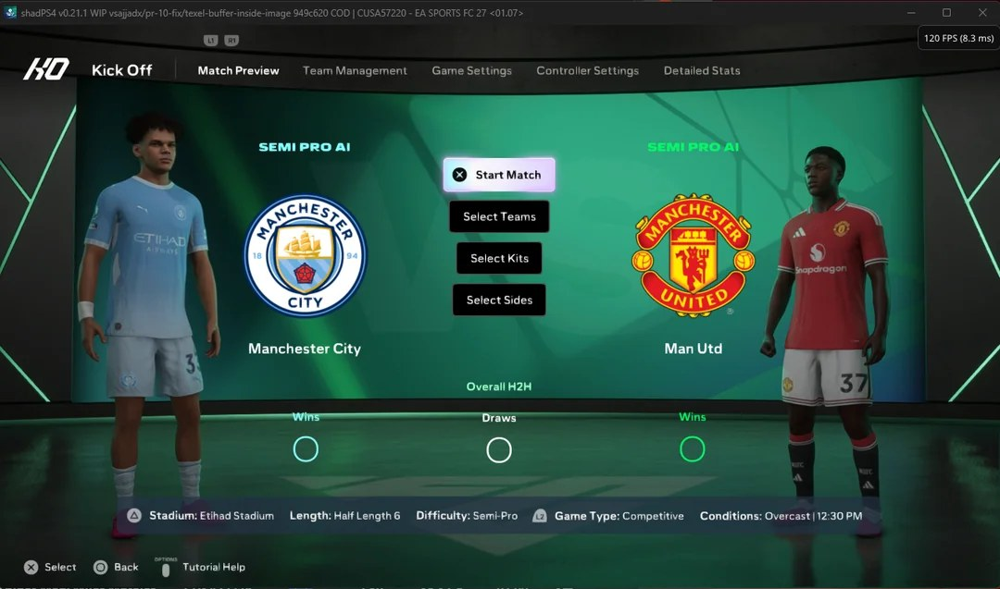 |

| inFAMOUS Second Son | DRIVECLUB |
| :---: | :---: |
| 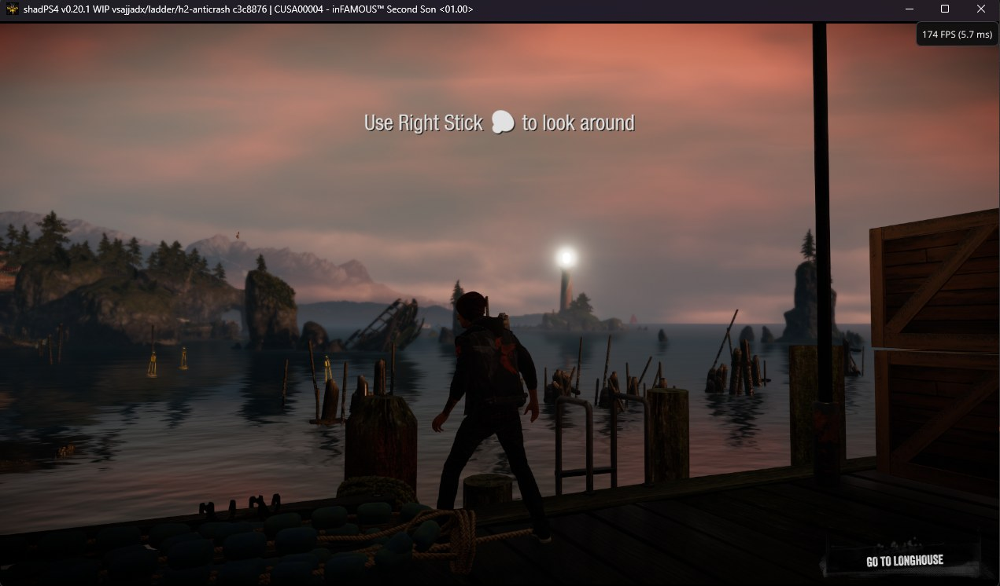 | 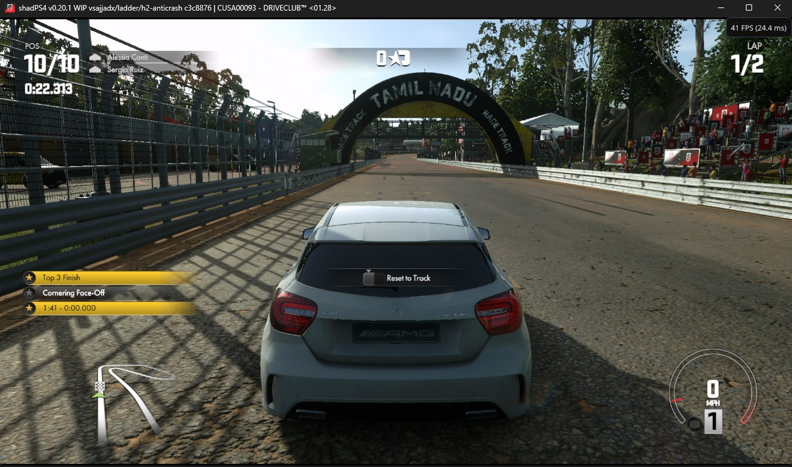 |

| The Grand Tour Game | The Order: 1886 |
| :---: | :---: |
| 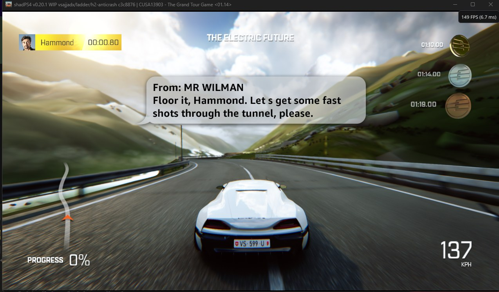 | 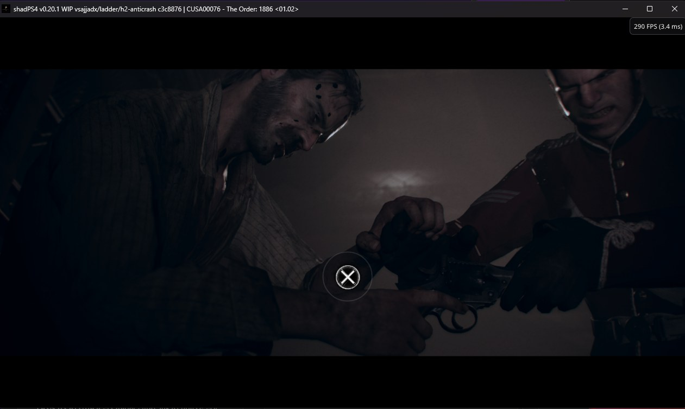 |

| NHL 24 | EA SPORTS UFC 4 |
| :---: | :---: |
| 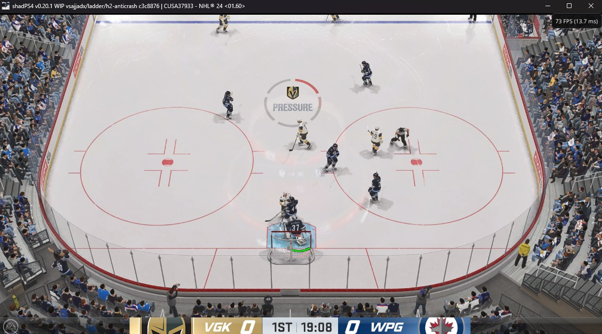 | 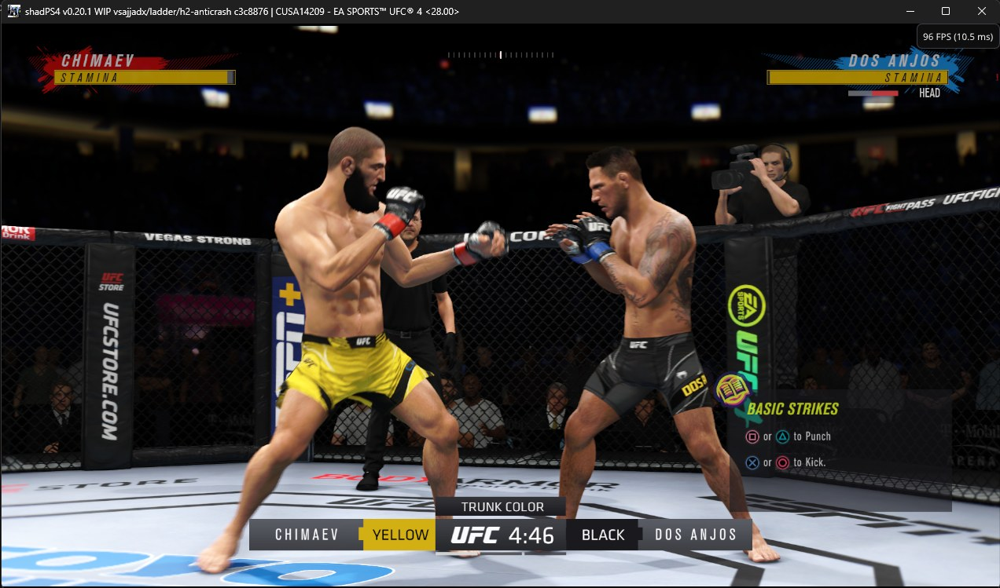 |

| Need for Speed Hot Pursuit Remastered | inFAMOUS First Light |
| :---: | :---: |
| 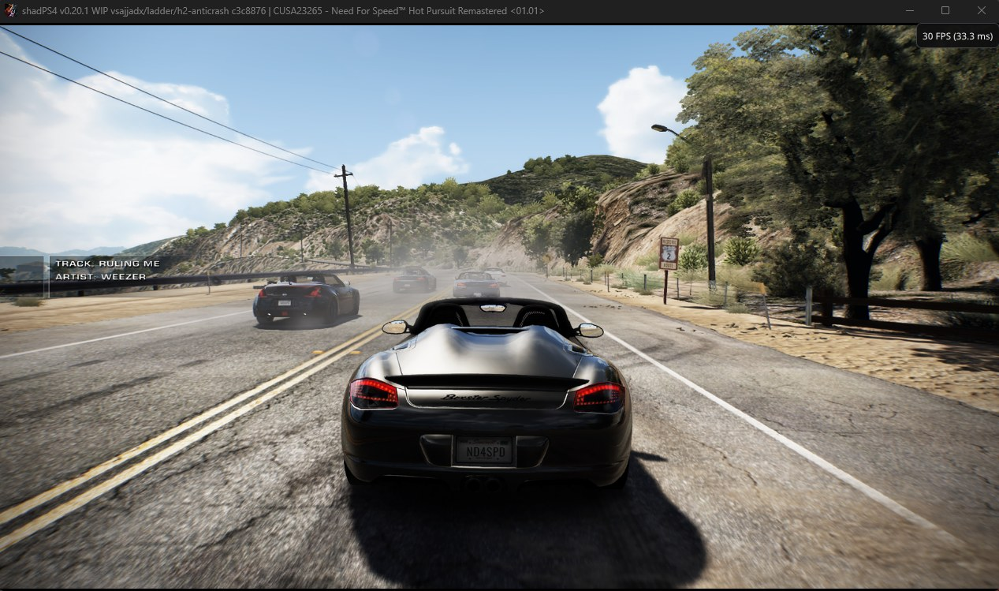 | 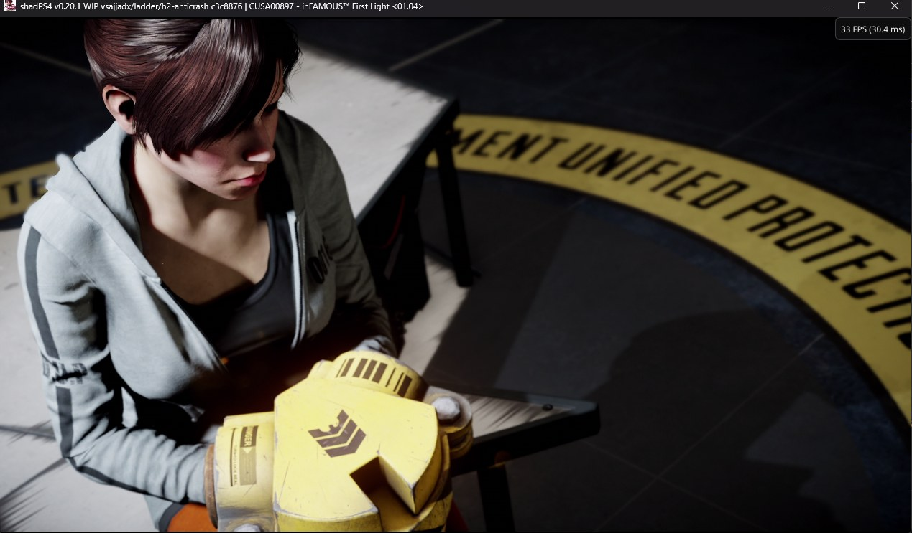 |

| Life Is Strange | Murdered: Soul Suspect |
| :---: | :---: |
| 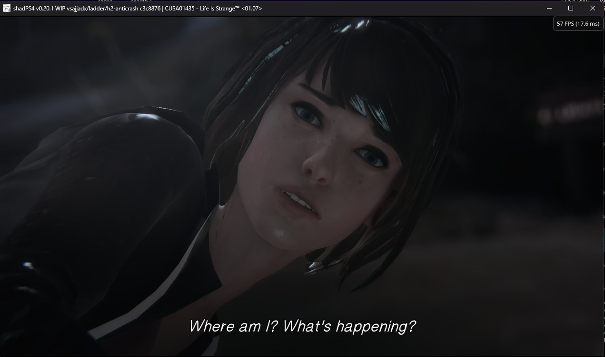 | 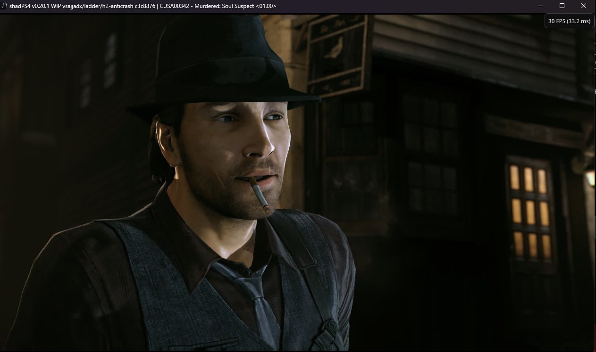 |

**DualSense support:** If you use a DualSense controller, games that have a separate controller audio channel will play it through the controller's speaker, with no special settings required.

## What is different from the official shadPS4

- **Fewer crashes.** Many errors that used to close the emulator are now caught, and the game
  keeps running.
- **Fewer freezes.** Fixes for games that got stuck on loading screens.
- **Better graphics.** Fixes for dark scenes, lighting and shadows, especially on NVIDIA cards.
- **Faster.** Better use of your CPU and GPU.
- **Frame generation (optional).** In game, `1` toggles it, or use the switch in the launcher
  settings. It is off by default.
- **Direct PKG execution.** Launch games from base, update and DLC PKGs with no extraction.
- **More games run.** Games like NHL 24, The Order: 1886, The Grand Tour Game and Need for Speed
  Hot Pursuit Remastered, which do not run on the official version, work here.
- **Launcher included.** One download, with automatic updates.
- **Always up to date.** The latest changes from the official shadPS4 are included.

## Author

- GitHub: [vsajjadx](https://github.com/vsajjadx)
- Reddit: [u/Unhappy_Advantage_10](https://www.reddit.com/user/Unhappy_Advantage_10/)

Found a bug? Open an [issue](https://github.com/vsajjadx/shadPS4/issues) with the log file
(`user/log`), and if it is a graphics glitch, a stage dump made with `9` then `8`.

## Made with the help of Claude

This fork was made with the help of **Claude**, the AI assistant by Anthropic. Claude studied
crash and freeze logs, found the causes, wrote the fixes, and brought in good fixes from other
open-source projects.

## Thanks

- The [**shadPS4**](https://github.com/shadps4-emu/shadPS4) team, for the emulator this fork is
  built on.
- Community forks and other open-source projects, for fixes and reference code.
- AMD [**FidelityFX**](https://github.com/FireBurn/FSR-Vulkan), for FSR frame generation.

## License

GPL-2.0-or-later, like the official shadPS4. This project does not include any games or
PlayStation system files. You need your own legally dumped games.
